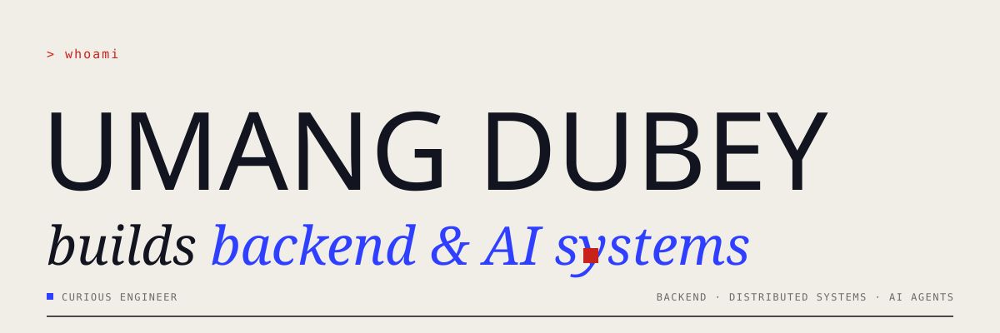
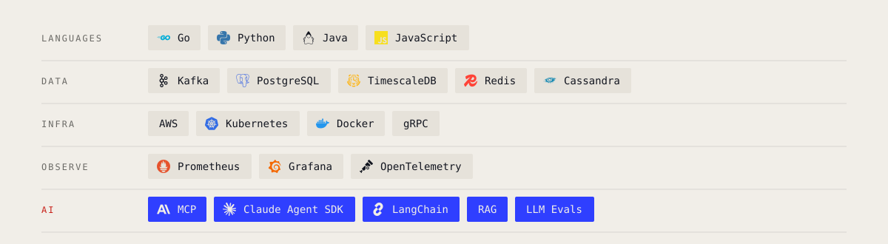

<a href="https://dev-umang-here.github.io/">
  <picture>
    <source media="(prefers-color-scheme: dark)" srcset="./assets/banner-dark.svg">
    
  </picture>
</a>

  
  
  
  

Backend engineer working on **high-throughput distributed systems** in fintech, and on the **AI agents** that help run them.
I care about the unglamorous parts: backpressure, idempotency, observability, and guardrails that live in code, not in the prompt.

 

<picture>
  <source media="(prefers-color-scheme: dark)" srcset="./assets/sec-building-dark.svg">
  
</picture>

<table>
<tr><td width="22%" valign="top"><a href="https://github.com/dev-umang-here/ai-sre-agent"><b>ai-sre-agent</b></a></td><td>Self-healing on-call agent: diagnoses alerts and proposes fixes, gated by an allow-list and circuit breaker. <code>Claude Agent SDK · MCP · Prometheus</code></td></tr>
<tr><td width="22%" valign="top"><a href="https://intellr.io/"><b>Intellr</b></a></td><td>Multi-agent hiring platform with screening, voice-interview and automation agents. <code>Multi-agent · Voice AI</code></td></tr>
<tr><td width="22%" valign="top"><b>Pantry Pilot</b></td><td>AI grocery planner for everyday meals: learns your food preferences, plans what to cook each day, and builds the grocery list and order to match. <code>MCP · LLM planning · Human-in-the-loop</code></td></tr>
</table>

 

<picture>
  <source media="(prefers-color-scheme: dark)" srcset="./assets/sec-stack-dark.svg">
  
</picture>

<picture>
  <source media="(prefers-color-scheme: dark)" srcset="./assets/stack-dark.svg">
  
</picture>

 

<i>Always building. Always learning.</i> &nbsp;■

